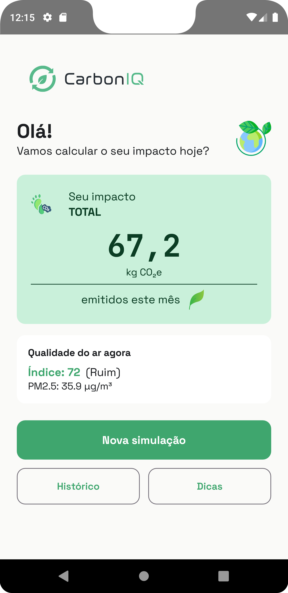
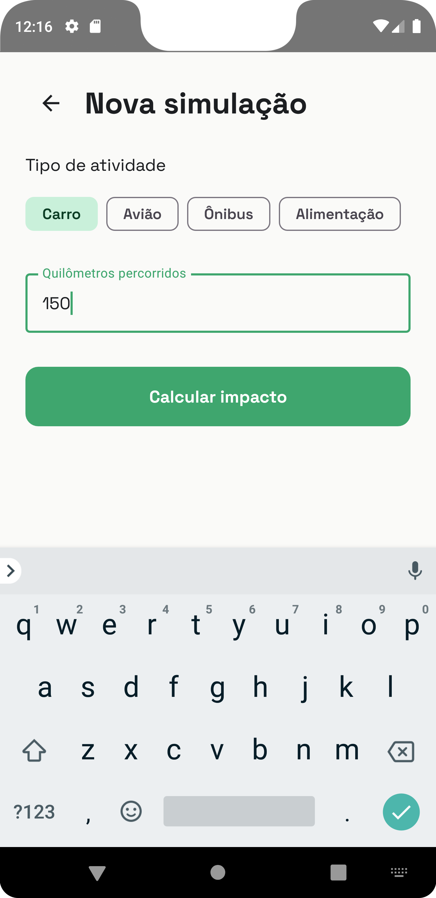
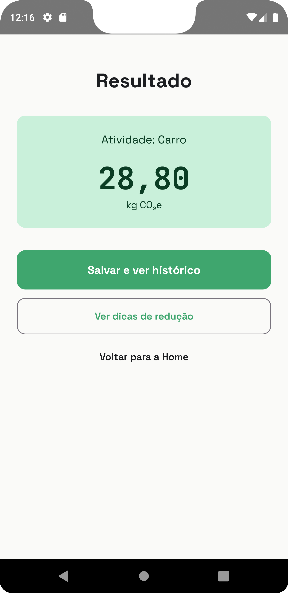
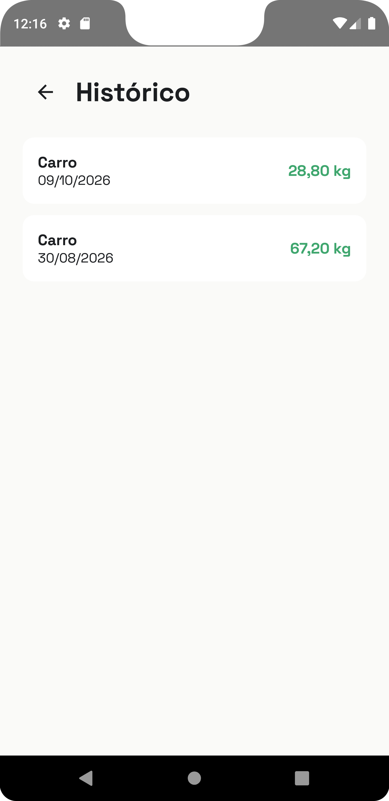
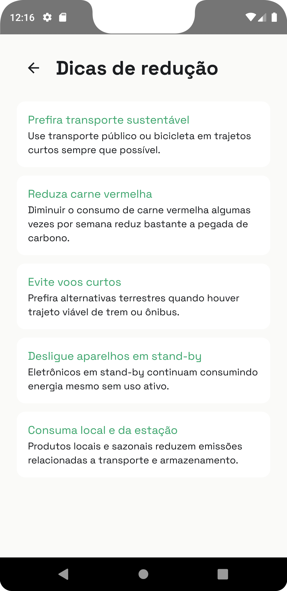

# CarbonIQ

> Simulador de impacto ambiental para Android: calcule a pegada de carbono das suas atividades do dia a dia e acompanhe o histórico.


O **CarbonIQ** é um MVP de aplicativo Android nativo voltado ao pilar **Ambiental (E)** do ESG. O usuário simula o impacto de CO₂ de atividades como deslocamento de carro, avião e ônibus, além de alimentação, salva cada simulação no próprio aparelho e acompanha o total acumulado. A Home também exibe a **qualidade do ar em tempo real**, obtida de uma API pública.

Projeto desenvolvido como atividade acadêmica do curso de Análise e Desenvolvimento de Sistemas da FIAP.

## Telas

| Home | Nova simulação | Resultado |
|:---:|:---:|:---:|
|  |  |  |

| Histórico | Dicas de redução |
|:---:|:---:|
|  |  |

## Funcionalidades

- **Simulação de impacto:** escolha entre Carro, Avião, Ônibus e Alimentação, informe a quantidade e veja o resultado em kg de CO₂e.
- **Rótulo dinâmico:** o campo de quantidade se adapta à atividade escolhida (por exemplo, "Quilômetros voados" para Avião).
- **Histórico persistente:** as simulações são salvas localmente com Room e listadas da mais recente para a mais antiga.
- **Total acumulado:** o card da Home soma todas as simulações salvas e atualiza sozinho a cada novo registro.
- **Qualidade do ar em tempo real:** consumo da API Open-Meteo Air Quality, com estados de carregamento, sucesso e erro (com botão para tentar novamente).
- **Dicas de redução:** recomendações práticas para diminuir a pegada de carbono.
- **Tema claro e escuro** com paleta e tipografia próprias (Space Grotesk e JetBrains Mono).

## Tecnologias

| Camada | Tecnologia |
|---|---|
| Linguagem | Kotlin |
| Interface | Jetpack Compose + Material Design 3 |
| Navegação | Navigation Compose |
| Estado | ViewModel + StateFlow (arquitetura MVVM) |
| Persistência local | Room (SQLite) |
| Rede | Retrofit + Gson |
| Serviço externo | [Open-Meteo Air Quality API](https://open-meteo.com/en/docs/air-quality-api) |

## Arquitetura

```
app/src/main/java/br/com/fiap/carboniq/
├── MainActivity.kt
├── data/                  # Room, Retrofit e repositórios
│   ├── AppDatabase.kt
│   ├── SimulationEntry.kt
│   ├── SimulationDao.kt
│   ├── SimulationRepository.kt
│   ├── AirQualityApi.kt
│   ├── AirQualityResponse.kt
│   ├── AirQualityRepository.kt
│   └── RetrofitInstance.kt
└── ui/
    ├── CarbonViewModel.kt # estado compartilhado entre as telas
    ├── navigation/        # rotas e NavHost
    ├── screens/           # Home, Nova simulação, Resultado, Histórico, Dicas
    └── theme/             # cores, tipografia e tema
```

Fluxo de dados: **Telas → CarbonViewModel → Repository → DAO/API**. As telas apenas observam o estado exposto pelo ViewModel e se redesenham automaticamente quando os dados mudam.

## Como rodar

**Pré-requisitos:** Android Studio (versão recente) e um emulador ou aparelho com Android 9 (API 28) ou superior.

```bash
git clone https://github.com/manucgois/carboniq-android.git
```

1. Abra a pasta do projeto no Android Studio.
2. Aguarde o Gradle sincronizar.
3. Selecione um emulador (ou conecte um aparelho) e clique em **Run**.

O app precisa de conexão com a internet apenas para o card de qualidade do ar. O restante funciona offline.

## APK

O APK de release está disponível na aba [Releases](../../releases) do repositório.

## Sobre os cálculos

Os fatores de emissão usados nas simulações são valores de referência simplificados, inspirados na metodologia do [GHG Protocol](https://ghgprotocol.org/calculation-tools-and-guidance), e servem para fins educativos nesta versão do MVP. O card de qualidade do ar usa coordenadas fixas (São Paulo).

## Próximos passos

- [ ] Usar a localização real do usuário na consulta de qualidade do ar
- [ ] Integrar uma fonte de dados de fatores de emissão atualizados
- [ ] Gráficos de evolução das emissões ao longo do tempo
- [ ] Mais categorias de atividade (energia elétrica, resíduos)
- [ ] Testes automatizados para ViewModel e repositórios

## Autoria

<!-- Preencha com seu nome e links, e combine com o grupo se quiser listar os demais integrantes -->
Desenvolvido por **Manuela Góis** · [LinkedIn](https://www.linkedin.com/in/manucgois/) · [GitHub](https://github.com/manucgois)
